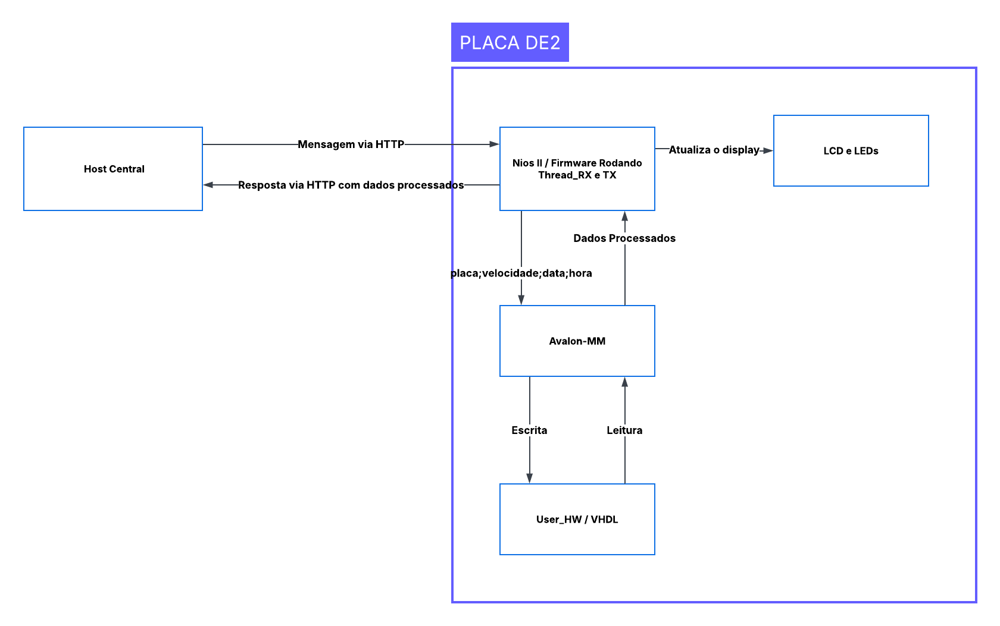

> **Sumário contendo o estado atual do projeto**
>
> Devem ser entregues um relatório contendo:
>
> - Descrição do objetivo do projeto e das interações com outros projetos.
> - Descrição dos módulos (VHDL, C, interação com o sistema operacional, se houver)
> - Detalhes de implementação.
> - `README.TXT` deve conter as informações necessárias sobre os arquivos.
>
> Em resumo, devo ser capaz de baixar o material e ter uma visão geral do projeto de cada equipe.  
> Se for muito grande, incluir no `README.TXT` o link para o local de armazenamento.

---

# PROJETO FINAL: Sistema de Radar e Painel de Mensagens Variáveis (PMV)

## ESTADO ATUAL DO PROJETO:

Atualmente o projeto encontra-se na fase de especificação da arquitetura e design.

## Descrição do Objetivo:

O objetivo do projeto é implementar um sistema embarcado em uma FPGA capaz de simular as operações de um radar de trânsito de mensagens variáveis.  
Esse projeto tem inspiração própria e não é baseado em nenhum dos projetos antigos disponibilizados, podendo servir como base para turmas futuras.

## Como Funciona?

Um operador no computador host utiliza uma página web (HTML + JavaScript) para atuar no Centro de Controle de Tráfego e enviar dados de veículos em um arquivo `.csv` padronizado, contendo placa, velocidade e data/hora via requisições HTTP operando e se comunicando com a placa FPGA.

Na placa, a Nios 2 recebe essas requisições e repessa os dados ao periférico (`User.HW`) feito em VHDL via barramento da Avalon-MM para a classificação em hardware. Após isso é exibido a mensagem no Display LCD e nos LEDS da Ciclone 10 e devolvido o diagnóstico processado na resposta HTTP para exibição e geração de um outro relatório com as autuações desse arquivo de veículos.

---

## Diagrama do projeto

  


## MÓDULOS DO PROJETO

### Modulo Do Host (Centro de Controle de Tráfego)

Esse módulo consiste em uma página web local (`.html`) que vai executar diretamente no navegador do usuário, conectado na mesma rede DHCP da DE2.

Suas funcionalidades incluem:

- Colocar um IP obtido pela placa via DHCP e configurar os parâmetros da via:
  - Esses parâmetros incluem limite de velocidade e dígito que deve ser considerado para controle de rodízio.
- Leitura local de um arquivo de lote (`.csv`) utilizando a API File do navegador e envio sequencial assíncrono para o servidor HTTTP no Nios.
- Envio unitário manual de veículos para teste.
- Exibição das autuações em tempo real retornadas pela FPGA e geração de um relatório de saída em `.csv`.

#### Exemplo de arquivo de lote:

```csv
placa;velocidade;data_hora
ABC1D23;54;12/11/2026 07:45:10
XYZ9K88;68;12/11/2026 08:12:33
BRA2E19;92;12/11/2026 14:20:05
QWE4R59;58;12/11/2026 18:05:40
JKL7M01;110;12/11/2026 23:50:12
```

---

### Modulo do Software Embarcado

O firmware é executado sobre o RTOS MicroC/OS-II integrado a pilha do InterNiche NicheStack TCP/IP 3.1 e seu sistema incluem sub módulos.

#### Inicialização da rede e DHCP:

Um arquivo `.c` do proprío simple socket nios inicia o driver que cuida da obtenção do endereço IP vai DCHP (o padrão do projeto simple socket).

#### Thread de Recepção:

- Fica escutando conexões TCP na porta HTTP configurada, realiza o parsing do conteúdo e dos parâmetros enviado pela página web:
  - Placa
  - Velocidade
  - Data/Hora
  - Limite de velocidade
  - Caractere de rodízio
- Encaminha para o processamento na fila do MicroC/OS-2

#### Thread de Processamento, Hardware e Transmissão HTTP:

Esse thread é responsável por integrar o software (rede e SO) e o hardware (`user_hw`). Ela consume os dados da Fila do MicroC/OS-II.  
Então é necessário empacotar os dados, porque o barramento Avalon-MM só se comunica por palavras de 32 bits.

- A placa do veículo que possui 7 bits é empacotada em duas palavras de 32 bits, enviadas aos registradores de escrita 3 e 4.
- Os parâmetros da via (velocidade e dígito) são concatenados em uma palavra de 32 bits e enviados ao registrador de escrita 2.
- São selecionados apenas a hora e os minutos da data/horário e são escritos no registrador de escrita 5 para que seja possível comparar com o horário de pico que o `user_hw` possui.
- Por último, a velocidade do carro é escrita no registrador 1, porque ela é responsável por disparar o trigger para o VHDL que fará com que seja iniciado o seu processamento.

Após o processamento por parte do `user_hw`, ocorre a leitura dos registradores de leitura para obter aclassificação da infração, total acumulado de multas e dados da última infração.

Com essa informações o firware atualiza o display LCD, aciona os leds da placa e envia esses dados como payload da responsa HTTP.

---

### USER_HW

O `user_hw` é conectado ao processador NIOS II por meio da interface Avalon Memory-Mapped (Avalon-MM), e possui 5 registradores de entrada e 4 registradores de saída, descritos abaixo:

#### REGISTRADORES DE ESCRITA

1. Velocidade média do veículo.
2. Limite de velocidade da via + caractere monitorado do controle de rodízio.
3. Primeiros 4 caracteres da placa Mercosul.
4. Últimos 3 caracteres da placa Mercosul.
5. Data/hora

#### REGISTRADORES DE LEITURA

1. Classificação de multa.
2. Total acumulado de infrações até o momento.
3. Quatros primeiros caracteres da placa infratora.
4. Carimbo de tempo da última infração registrada.

O processamento é feito de forma combinacional.  
Possui um contador de veículos que é incrementado quando a velocidade é escrita no registrador 1 e um contador de infrações. Possui também um registrador interno para armazenar a última infração.

1. Compara os valores do registradores de entrada 1 e 2, e descobre se o veículo está dentro da velocidade da via (`Status = Sem infração`), se está até 20% acima (`Status = Infração moderada`) ou se está mais de 20% acima (`Status = Infração Grave`).  
   O status é escrito no registrador de saída 1.

2. Faz uma comparação de igualdade entre o último dígito da placa que está no registrador de entrada 4 e o dígito recebido no registrador de entrada 2 para saber se o veículo poderia estar circulando (`Status = Sem infração`) ou não (`Status = Infração moderada`).  
   O status também é escrito no registrador de saída 1.

3. Faz uma comparação do valor armazenado no registrador 5 com o horário de pico.

4. Se o status foi alterado para infração:
   - O contador de infrações é incrementado e escrito no registrador de saída 2.
   - O valor dos registradores de entrada 4 e 5 são armazenados no registrador interno e nos registrtadores de saída 3 e 4.

5. Se o status foi de não infração:
   - O valor do contator não se altera e é escrito no registrador de saída 2.
   - Os registradores de saída 3 e 4 são escritos valores nulos, para indicar que não houve infração. O registrador interno não é alterado.
